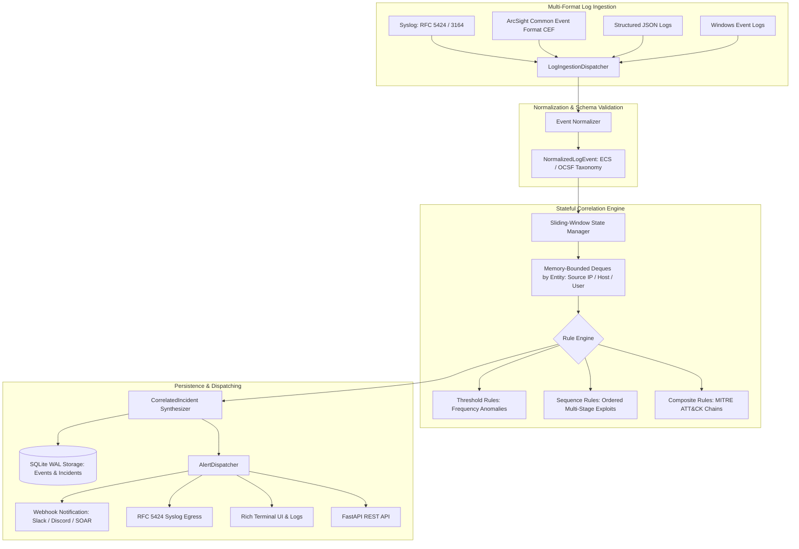

# Security Log Correlation Engine (`log-corr`)

High-Performance Multi-Stage Threat Detection, ECS/OCSF Event Normalization, Sliding-Window Stream Correlation, MITRE ATT&CK Attack Chains, and Real-Time Alert Dispatching.

[](https://github.com/Krish9800/security-log-correlation-engine/actions)
[](https://opensource.org/licenses/MIT)
[](https://www.python.org/)
[](https://www.elastic.co/guide/en/ecs/current/index.html)
[](https://attack.mitre.org/)

---

## Overview & Problem Statement

Modern enterprise Security Operations Centers (SOCs) ingest tens of millions of raw log events every day from disparate operating systems, perimeter firewalls, directory services, and network appliances. Analyzing raw logs in isolation causes severe alert fatigue and misses subtle multi-stage attack campaigns: an attacker performing initial password spraying, followed by a privilege escalation attempt, and culminating in unauthorized data egress might generate separate, low-severity log lines hours apart across different servers.

**Security Log Correlation Engine (`log-corr`)** solves this problem through stateful, sliding time-window stream correlation. It ingests heterogenous log formats (Syslog RFC 5424/3164, ArcSight CEF, structured JSON, and Windows Event logs), normalizes them into a unified Elastic Common Schema (ECS) / Open Cybersecurity Schema Framework (OCSF) taxonomy, tracks stateful entity interactions over configurable temporal windows, and synthesizes correlated high-confidence incident alerts mapped directly to the MITRE ATT&CK framework.

---

## Architecture & Data Flow



---

## Verified Features & Capabilities

- **Resilient Multi-Format Parsing**: Auto-detects and extracts structured security fields from Syslog (RFC 5424/3164), ArcSight CEF, structured JSON, and Windows Security event logs.
- **Unified Security Taxonomy**: Maps heterogeneous log events into standard `NormalizedLogEvent` structures with typed ISO-8601 timestamps, network 5-tuples (`src_ip`, `dst_ip`, `src_port`, `dst_port`), actor identities, and severity classes.
- **Memory-Bounded Sliding Windows**: Deque-backed sliding buffers isolate events per correlation entity (`source_ip`, `target_user`, `host`) with stream-relative time eviction preventing unbounded memory growth.
- **Multi-Stage Detection Paradigms**:
  - *Threshold Rules*: Detect high-volume anomalous spikes (e.g. 5 failed logins within 60 seconds).
  - *Sequence Rules*: Detect causal sequences of stages (e.g. reconnaissance → authentication bypass → privilege escalation).
  - *Composite Attack Chains*: Correlate cross-tactic MITRE ATT&CK progression over extended observation windows.
- **Dynamic YAML Rule Catalog**: Extensible rule engine loaded from built-in standard catalogs or external YAML rule directories.
- **ACID-Compliant WAL Storage**: SQLite storage running in Write-Ahead Logging (WAL) mode with busy timeout handling, preserving audit trails for events and incidents.
- **Dual-Interface Management**: Includes an async FastAPI REST API and a Typer/Rich command-line administrative interface.

---

## Technology Stack

- **Core Engine & CLI**: Python 3.12+, Typer, Rich, Pydantic v2
- **Persistence**: SQLite (WAL mode, foreign key enforcement)
- **Web API**: FastAPI, Uvicorn, Starlette
- **Testing & Quality**: Pytest, Pytest-Asyncio, Pytest-Cov, Ruff, Mypy (strict typing)
- **Containerization**: Rootless multi-stage Docker (`UID 10001`)

---

## CLI Reference & Operational Usage

The platform installs the `log-corr` CLI tool:

```bash
# 1. Inspect engine version and active configuration
log-corr version

# 2. Ingest raw log file into local SQLite storage
log-corr ingest sample_logs.cef --format cef --db data/correlation.db

# 3. Stream a log file through the correlation engine in real-time
log-corr correlate access.log --cooldown 300 --output-alerts alerts.json

# 4. Correlate using custom external YAML detection rules
log-corr correlate security_events.json --rules-dir ./custom_rules/

# 5. List and inspect stored security incidents
log-corr incidents --status OPEN --severity high --limit 20

# 6. View the active correlation rules catalog
log-corr rules
```

---

## REST API Control Plane

Launch the async FastAPI daemon:

```bash
uvicorn log_corr.api.app:app --host 127.0.0.1 --port 8000
```

Interactive OpenAPI documentation is available at `http://127.0.0.1:8000/docs`.

### Primary Endpoints

| Method | Endpoint | Description |
|:-------|:---------|:------------|
| `GET` | `/health` | Health check and engine telemetry |
| `POST` | `/api/v1/logs/ingest` | Ingest single or bulk raw log records |
| `GET` | `/api/v1/incidents` | Query correlated incidents (filterable by status and severity) |
| `GET` | `/api/v1/incidents/{incident_id}` | Retrieve incident details with underlying triggering events |
| `GET` | `/api/v1/rules` | List all registered correlation rules |
| `POST` | `/api/v1/rules` | Register custom correlation rule dynamically |
| `DELETE` | `/api/v1/rules/{rule_id}` | Deregister a correlation rule |
| `GET` | `/api/v1/alerts` | Query historical dispatched alert notifications |

---

## Installation & Setup

### Prerequisites

- Python 3.12 or higher
- Git

### Local Installation

```bash
# Clone the repository
git clone https://github.com/Krish9800/security-log-correlation-engine.git
cd security-log-correlation-engine

# Create and activate virtual environment
python3 -m venv .venv
source .venv/bin/activate

# Install in editable mode with development dependencies
pip install --upgrade pip
pip install -e ".[dev]"
```

---

## Testing & Quality Assurance

Run the comprehensive test suite covering unit tests, integration pipelines, and adversarial scenarios:

```bash
# Run all unit, integration, and security tests
pytest

# Run tests with code coverage report
pytest --cov=log_corr --cov-report=term-missing

# Run code style and lint checks
ruff check .
ruff format --check .

# Run static type verification
mypy src/log_corr
```

---

## Security Model & Threat Boundaries

The project includes a formal STRIDE threat model documented in `docs/threat_model.md`:

- **Input Validation**: All raw log streams are sanitized via Pydantic schema validation. Malformed or poisoned log lines are directed to error handlers without crashing the correlation thread.
- **Memory Boundary Defense**: Sliding correlation windows enforce maximum event bounds per entity key, preventing denial-of-service (DoS) via log flooding.
- **SQL Injection Prevention**: SQLite queries strictly utilize parameterized SQL statements; dynamic table manipulation is prohibited.
- **Least Privilege Runtime**: Docker images execute as unprivileged user `UID 10001` with drop-capabilities (`cap_drop: ALL`).

---

## Limitations & Known Issues

- **In-Memory Window Buffer**: Sliding windows are currently held in memory for low-latency stream processing. For multi-node distributed clustering, Redis or Kafka integration is planned.
- **Out-of-Order Clock Drift**: Log streams with timestamp skew greater than the configured window size may require clock synchronization (NTP).

---

## License & Responsible Use

This project is licensed under the **MIT License** - see the [LICENSE](https://opensource.org/licenses/MIT) details.

> [!NOTE]
> Designed for defensive security operations, threat hunting, and blue team detection engineering. Ensure log collection and processing comply with applicable internal data governance and privacy policies.
